# LumaFlow

**Find your rhythm. Stay in the flow.**

A minimal, ambient study timer for focused work, deliberate breaks and consistent study habits. It runs entirely in your browser: no account, no server, no network calls.

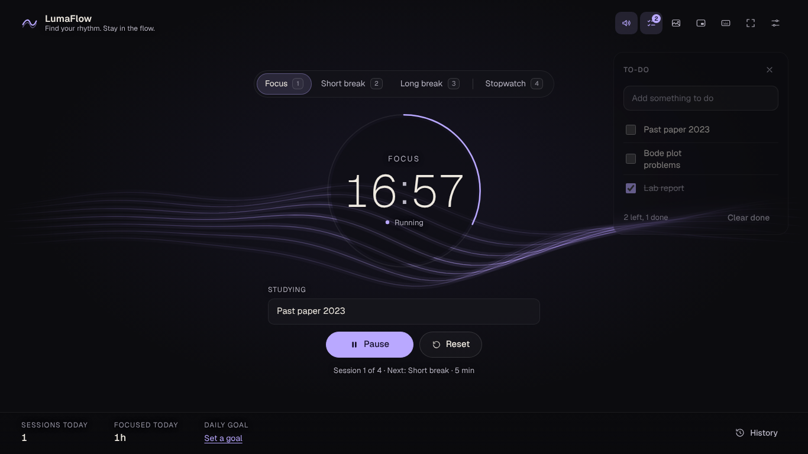

## Features

- **Focus, short break and long break** timers. Defaults are 25 / 5 / 15 minutes, and every length is configurable (1 to 180 minutes for focus).
- **Reliable timing.** The countdown is computed from an absolute end timestamp, never from counting interval ticks, so it stays correct through background tabs, throttling, laptop sleep and reloads.
- **Stopwatch.** For open-ended work with no target. It counts up, pauses and resumes, and saves a history entry when you finish. Runs under a minute are not saved. If the device sleeps or the tab is closed while it runs, it pauses at the last moment the app was alive, so time away is never counted as study time.
- **Six backgrounds**, chosen in Settings or cycled with `B`: Ribbon (the original), Nebula (a dense starfield over muted indigo clouds), Aurora, Ripples, Drift (warm dust in lamplight) and Still (no motion). Each one slows to a stop when you pause, and none of them speeds up or brightens as time runs out.
- **Background sound:** a thunderstorm (rain with distant thunder), plain rain, brown noise, "Match background" (each background picks its own), or nothing. By default it starts with each focus session or stopwatch run and fades out when you pause or finish. Breaks stay quiet. `M` mutes it for the rest of that session, and you can turn the auto start off in Settings. Everything is generated in the browser, so there are no audio files to load.
- **Binaural beats (optional, off by default).** Theta 6 Hz, alpha 10 Hz, beta 15 Hz or gamma 40 Hz. One quiet tone plays in each ear, 220 Hz on the left and 220 Hz plus the beat on the right, under the ambient sound. It needs headphones. Research on whether beats help focus is mixed, so treat it as a preference, not a method.
- **Small floating timer.** `P` or the button in the top bar opens a tiny always-on-top window with the clock and one button (Start, Pause, Resume, then the next phase when one ends), so you can see it while working in another window. Chrome and Edge float a real page. Browsers with only video picture-in-picture (Safari) float a video of the clock and use its play and pause controls. Firefox has neither, so the button does not appear there.
- **Fades while you focus.** After 6 quiet seconds in a running session, everything except the clock and the main button fades out. Move the mouse or press a key to bring it back. Turn it off in Settings.
- **Install it and use it offline.** It is a progressive web app, so Chrome, Edge and Safari can install it from the address bar or share menu. After the first load it opens without a network.
- **Your data is yours.** Settings has a backup download (one JSON file), a restore that merges into what you have, and a CSV export of your sessions.
- **To-do list** beside the timer on wide screens. Type an item and press Enter, tick items off, delete them, and clear what is done. "Study" copies an item into the Studying field, and when that session finishes you can tick the item off with one press. It fades back while a session runs and returns when you point at it. Hide it with the close button if you want a bare screen. On narrow windows and phones it opens as a dialog from the checklist button. Up to 100 items, saved in your browser.
- **Session tracking.** Completed sessions and total focus time for today, plus an optional daily goal shown as a quiet progress bar. The hint under the clock says which focus session of the cycle you are on ("Session 2 of 4").
- **Session notes.** Write what you are studying before you start, and add an optional "review next" note when a session ends.
- **History.** A 7-day chart of focus time, then date, time, duration, topic and whether each session finished or ended early. Delete single entries or clear everything (with confirmation).
- **Optional extras, all off by default:** soft chime, browser notification, automatic phase transitions (capped at 4 in a row, so it never loops unattended).
- **Keyboard first**, with a built-in shortcut list (`?`).
- **Accessible:** semantic HTML, labelled controls, visible focus rings, status shown with text and icons rather than colour alone, screen reader announcements for state changes, and full `prefers-reduced-motion` support.

| Nebula | Aurora |
| --- | --- |
| 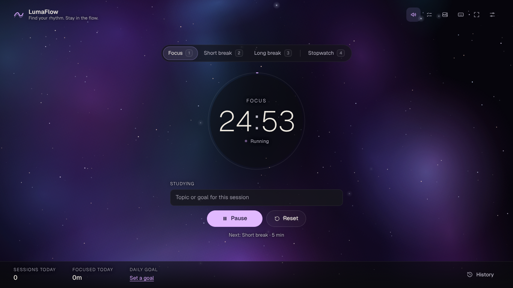 | 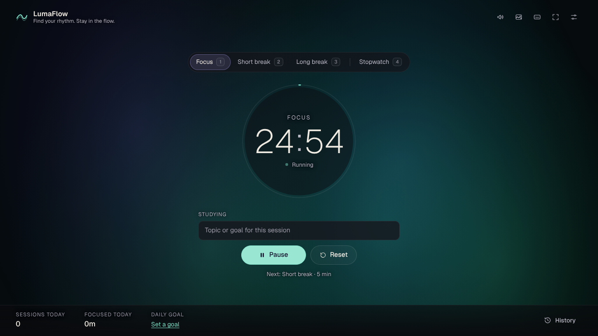 |

| Ripples | Drift |
| --- | --- |
| 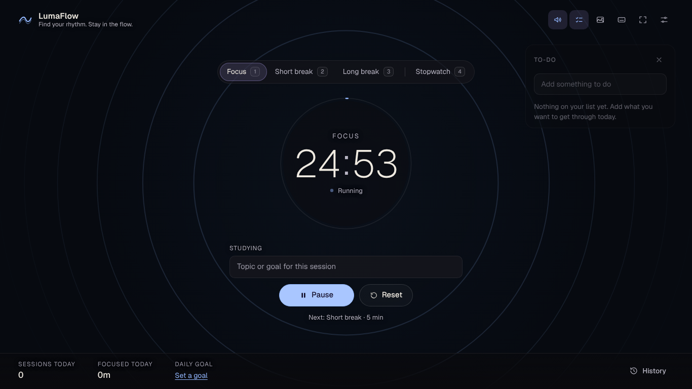 | 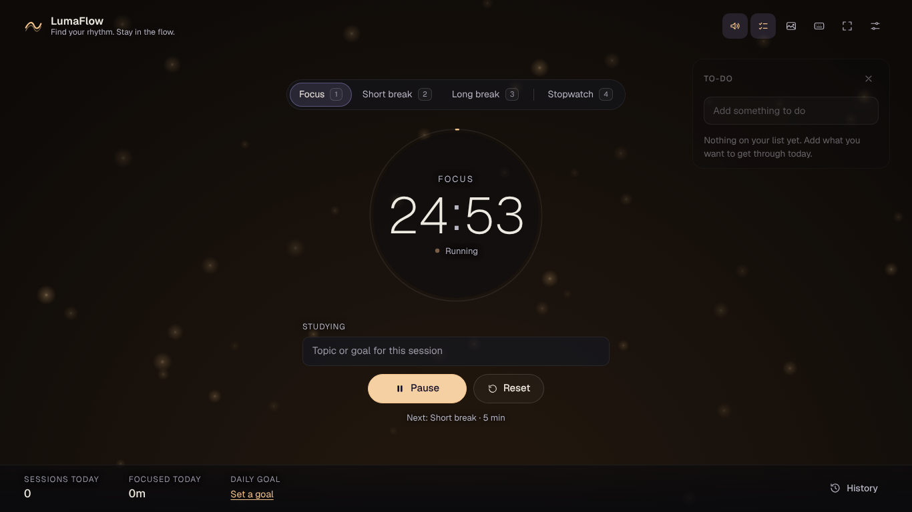 |

| Stopwatch | Session complete |
| --- | --- |
| 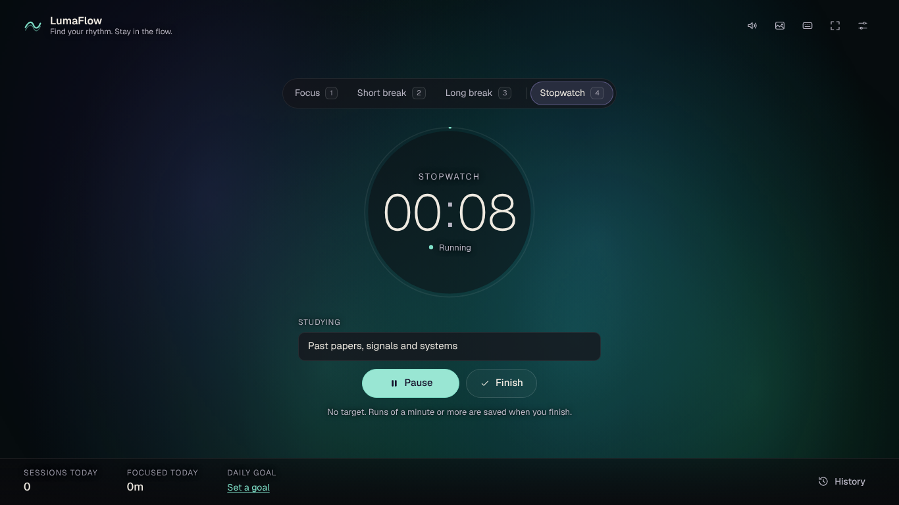 | 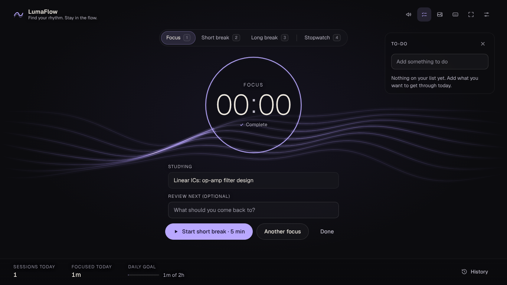 |

| To-do list | Settings |
| --- | --- |
| 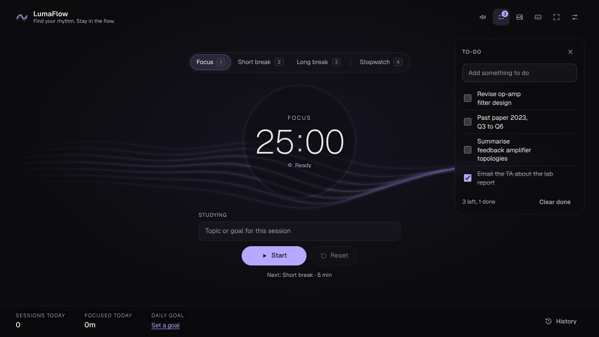 | 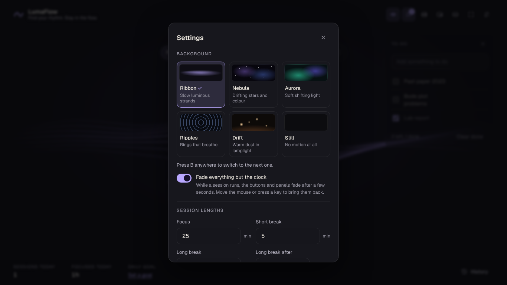 |

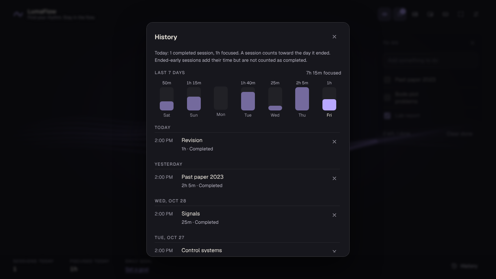

On a phone:

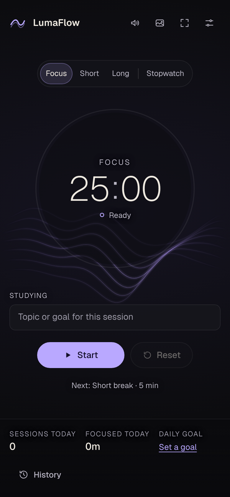

## Tech stack

React 19, TypeScript, Vite, plain CSS, Canvas 2D for the backgrounds, WebAudio for the chime and background sound. Geist font via `@fontsource-variable/geist` (bundled, no CDN). Tests use Vitest and Playwright.

## Prerequisites

- Node.js 22.12 or newer (required by Vitest 5; the app itself builds on Node 20.19+)
- npm

## Install and run

```bash
npm install
npm run dev
```

Open http://localhost:5173.

## Commands

| Command | What it does |
| --- | --- |
| `npm run dev` | Start the dev server |
| `npm run build` | Typecheck and build to `dist/` |
| `npm run preview` | Serve the production build on port 4173 |
| `npm run typecheck` | TypeScript check only |
| `npm test` | Unit tests (Vitest) |
| `npm run test:e2e` | Browser tests (Playwright, builds and serves the production bundle) |

For the browser tests, install a browser once with `npx playwright install chromium`. To use a Chromium you already have, set `LUMAFLOW_CHROMIUM` to its path.

To use the built app, serve `dist/` with any static file server (`npm run preview` is the easiest). Opening `index.html` straight from disk will not work because the app uses ES modules.

## Keyboard shortcuts

| Key | Action |
| --- | --- |
| `Space` | Start, pause or resume |
| `R` | Reset, or finish the stopwatch (press twice when a run is under way) |
| `1` / `2` / `3` | Focus / short break / long break |
| `4` | Stopwatch |
| `B` | Next background |
| `M` | Background sound on or off |
| `T` | Jump to the to-do list and start typing |
| `P` | Small floating timer on or off |
| `F` | Toggle full screen |
| `?` | Show the shortcut list |
| `Esc` | Cancel a pending reset, or close a panel |

Shortcuts are ignored while you type in a field or while a dialog is open. When a button has focus, `Space` presses that button instead.

## How the timer works

- A running phase stores `targetAt` (epoch milliseconds). Remaining time is always `targetAt - now`. A pause stores the remainder, and resume sets a new `targetAt`.
- The state is saved to `localStorage` every few seconds and on every action. After a reload, the app recomputes everything from the saved timestamps.
- If a phase ended while the app was closed or the device asleep, it is marked complete **silently**: no sound, no notification, no automatic next phase, and a short message explains what happened. The session is logged at its real end time.
- Each phase has a unique id, and the log refuses duplicate ids, so a session can only be recorded once however many times the page reloads or ticks.
- **Ending a focus session early** (reset or switching mode after at least 1 minute of progress) logs the time spent as "ended early". Early sessions add to today's focused time but are not counted as completed sessions. Under a minute is not logged.
- **Daily totals** use your local calendar day. A session belongs to the day on which it ended.
- **The stopwatch** stores when it started and how much it had already counted, so its reading also comes from the clock. A gap longer than 2.5 minutes between heartbeats counts as sleep or a closed tab: the stopwatch pauses at the last heartbeat and says so. Finishing saves one entry, marked as a stopwatch run, and adds to today's focused time.
- **Only one thing runs at a time.** Starting the stopwatch ends a running focus session early (logging the time so far), and leaving a running stopwatch saves it first. Both ask for a second key press when real progress would be saved.

## Data and privacy

Everything stays in your browser's `localStorage` under keys starting with `lumaflow.v1.`: settings (including your background and sound), the current timer and stopwatch state, your to-do list, and up to 1000 history entries. Nothing is sent anywhere. Clear it from the History panel, or by clearing site data in your browser. If `localStorage` is unavailable (some private modes), the app still works for the current page but cannot remember anything.

## Known limitations

- **One tab at a time.** Two tabs can both fire a chime or notification for the same session. The history still records it once.
- **Fully backgrounded tabs.** Browsers can throttle timers to about once a minute. The recorded time is exact, but the chime or notification may arrive up to roughly a minute late.
- **Chime needs a gesture.** Browsers block audio until you interact with the page. Starting the timer counts, so this only matters if you enable sound mid-session and never touch the page.
- **Notifications** need explicit permission and a secure context (`localhost` or HTTPS).
- **The binaural beats have not been listened to or measured.** The tests check that two oscillators start, one per ear, at the right frequencies. They cannot check that it sounds right in headphones or that it does anything for you.
- **The small floating timer is tested against stand-ins.** Chrome's picture-in-picture window and the video fallback are replaced by fakes in the browser tests, which cover the clock, the button, `P`, closing and a refused window. It has not been run in a headed Chrome, Edge or Safari. Chrome only opens it from a click or key press, so a refusal leaves everything closed.
- **The fade after a pause in activity** counts mouse, key, touch and scroll events. Faded items ignore the pointer, so the first tap on a faded screen should only bring it back. That has not been tried on a real touchscreen.
- **Offline use** needs one normal load first. A new version is picked up on the load after it is deployed.
- **The sounds have not been listened to** on the machine they were built on. They are synthesised from filtered noise, with randomly timed thunder, and the tests check the generated audio (level, loop joins, thunder fading to silence) and that it starts and stops with the session. If the mix is too loud, too bright or too busy for you, change the volume or pick Rain or Brown noise in Settings.
- **After a reload mid-session** the browser will not start audio until you click or press a key once, so the sound resumes on your first interaction.
- **Backgrounds on slow hardware.** The animated ones are capped at 30 frames per second and stop completely when the tab is hidden or the timer is paused. If your machine struggles, pick Still.
- **No cross-device sync.** By design.
- Automated tests run in Chromium only. Firefox and Safari should work but are unverified.

LumaFlow is a focus aid. It is not a substitute for active recall, practice questions, spaced repetition or sleep, and it makes no claims about improving memory or marks.

## Project structure

```
src/
  core/        Pure logic, no React: timer.ts (state transitions), stats.ts, storage.ts,
               format.ts, controller.ts (persistence, ticking, events), plus unit tests
               stopwatch.ts (count-up state, away handling), tasks.ts and taskStore.ts (to-do list)
  flow/        Background engine: flow.ts (ribbon maths), scene.ts (shared interface),
               scenes/ (ribbon, nebula, aurora, ripples, drift, still)
  components/  TimerDial, ModeTabs, Controls, StatsDock, TodoList, TodoDialog, other dialogs, FlowCanvas
  hooks/       useTimer, useTasks, useShortcuts, useReducedMotion, useIdle, usePip
  pip/         Floating timer: opening the window, the video fallback, shared display data
  feedback/    chime.ts, ambient.ts (rain, storm, brown noise), ambientData.ts (sample generators),
               audio.ts (shared context), notify.ts (Notifications API)
  styles.css
e2e/           Playwright browser tests
pwa/           Service worker template (the build adds the precache list and a version)
public/        Web app manifest and icons
docs/screenshots/
```

## License

MIT. See [LICENSE](LICENSE). The Geist font is bundled under its own SIL Open Font License via `@fontsource-variable/geist`.
